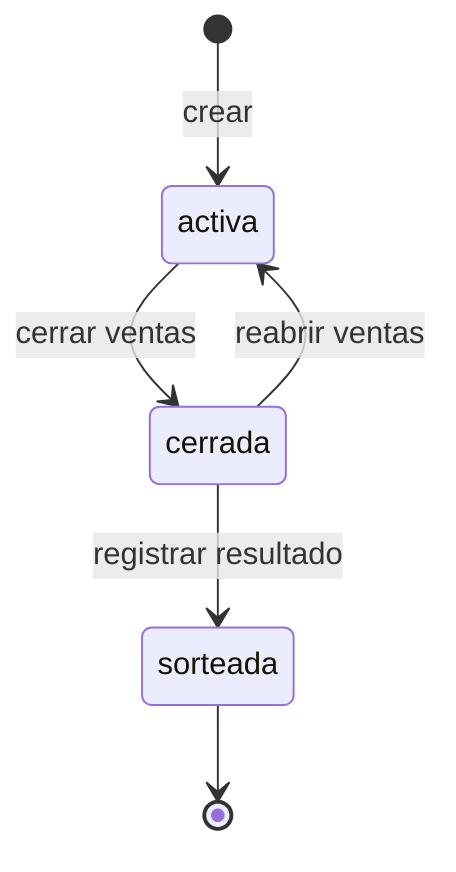
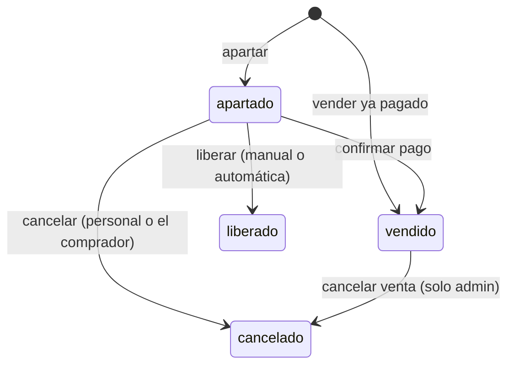

# Flujos de perINDIO

Quién usa el sistema, qué puede hacer cada quien, por qué estados pasan las rifas, los pedidos y los números, y cómo es cada flujo de principio a fin.

## Actores

| Actor | Cómo entra | Para qué |
| --- | --- | --- |
| **Comprador** | Sin cuenta, con el enlace público de la rifa (`/r/<enlace>`) | Ver números libres, apartar, consultar su pedido y mandar su comprobante |
| **Operador** (vendedor) | Cuenta creada por el admin | Apartar y vender en el tablero, confirmar pagos, liberar y dar seguimiento a pedidos |
| **Administrador** | Cuenta creada por el admin (o `pnpm usuario:crear`) | Todo lo del operador, más rifas, sorteo, usuarios y perfil del organizador |
| **Sistema** | Cron o al abrir un tablero | Liberar los apartados vencidos de las rifas con liberación automática |

## Permisos

| Acción | Comprador | Operador | Admin |
| --- | :-: | :-: | :-: |
| Ver la página pública y apartar (con límites) | ✓ | | |
| Ver su pedido y cancelarlo mientras no esté pagado (con su enlace secreto) | ✓ | | |
| Tablero: apartar, vender, confirmar pagos, liberar | | ✓ | ✓ |
| Cancelar un apartado sin pagar | | ✓ | ✓ |
| Cancelar una venta **ya pagada** (devolución) | | | ✓ |
| Pedidos, historial, PDF, resumen y ventas por vendedor | | ✓ | ✓ |
| Crear, configurar, publicar, cerrar y eliminar rifas | | | ✓ |
| Premios, cerrar ventas y registrar el sorteo | | | ✓ |
| Usuarios y perfil del organizador | | | ✓ |
| Cambiar su propia contraseña (Mi cuenta) | | ✓ | ✓ |

Cada regla se revisa en el servidor (acciones y páginas), no solo ocultando botones. Un operador que abre una pantalla de admin por URL regresa al inicio. Todo usuario solo ve los datos de su organizador.

## Estados

### Rifa

- **activa:** se puede apartar y vender (en el panel; en la página pública solo si además está **publicada**).
- **cerrada:** nadie aparta; se siguen cobrando y liberando los apartados existentes. Al cerrar se puede liberar de una vez lo que siga sin pagar.
- **sorteada:** final y de solo lectura. La base rechaza cualquier cambio a sus asignaciones y la app no deja editar la rifa ni sus premios.

La bandera **publicada** (página pública encendida o apagada) es independiente del estado.

### Pedido

Un pedido agrupa los números de una misma solicitud y tiene un **folio** de 6 caracteres (para buscarlo) y un **enlace secreto** (para el comprador). Su estado se calcula a partir de sus números:

| Estado | Cuándo |
| --- | --- |
| Pago pendiente | Tiene números apartados sin pagar dentro del plazo |
| Vencido | Algún número sin pagar ya pasó su plazo |
| Pagado en parte | Unos números pagados y otros pendientes |
| Pagado | Todos sus números vigentes están pagados |
| Liberado o cancelado | Ya no le queda ningún número vigente |

### Número (asignación)

Un número está **disponible** cuando no tiene asignación vigente (apartado o vendido); un apartado está **vencido** cuando pasó su fecha límite sin pago. La base garantiza que un número nunca tenga dos asignaciones vigentes.

## Flujos

### Comprador (página pública)

1. Recibe el enlace de la rifa (WhatsApp, redes o el QR impreso en el PDF de disponibles).
2. En `/r/<enlace>` ve precio, fecha del sorteo, premios y la cuadrícula de números **libres u ocupados**; nunca ve nombres de otros compradores.
3. Elige números (hasta el máximo por comprador de la rifa), escribe su nombre y WhatsApp y aparta.
   - Si alguien ganó alguno de esos números un instante antes, no se aparta ninguno y se le dice cuál.
   - Límites: máximo de números sin pagar por teléfono, 5 pedidos por hora por conexión y un campo trampa contra bots.
4. Llega a la página de su pedido (`/p/<enlace secreto>`): folio, números, total, **plazo para pagar** y los datos de pago (los de la rifa o, si no tiene, los del organizador).
5. Paga por transferencia o en efectivo y toca **Enviar comprobante por WhatsApp**, que abre el chat del organizador con folio, números y total ya escritos.
6. Cuando el personal confirma el pago, la misma página muestra **Pagado**. Si ya no quiere los números, puede **cancelar su apartado** mientras no esté pagado.
7. Si no paga a tiempo, sus números se liberan (solos o a mano, según la rifa).
8. Después del sorteo, la página de la rifa muestra los resultados con el nombre del ganador abreviado ("María G.").

### Operador o vendedor (panel)

1. Entra con su cuenta; ve el resumen de todas las rifas.
2. **Apartar o vender en persona:** en el tablero de la rifa elige números, captura al comprador y aparta (o vende si ya pagó). Se crea un pedido a su nombre como vendedor, con botón para mandarle al comprador su enlace por WhatsApp.
3. **Cobrar:** cuando llega un comprobante, en **Pedidos** busca el folio, el nombre o el teléfono y toca **Confirmar pago**. El filtro predeterminado es "Por cobrar".
4. **Dar seguimiento:** desde Pedidos manda un **recordatorio por WhatsApp** (folio, números, monto y vencimiento ya escritos) o copia el enlace del pedido.
5. **Liberar:** libera los apartados sin pagar que ya no se van a cobrar; quedan en el historial.
6. Consulta el historial, los PDF y las **ventas por vendedor**.

### Administrador

1. **Perfil del organizador:** nombre, WhatsApp para comprobantes, datos de pago y logo. Aparecen en la página pública, en los pedidos, en los mensajes de WhatsApp y en los PDF.
2. **Usuarios:** crea vendedores con una contraseña temporal que se muestra una sola vez; cambia nombre y rol, restablece contraseñas y desactiva o reactiva cuentas. Siempre queda al menos un administrador activo y nadie puede quitarse el rol ni desactivarse a sí mismo.
3. **Rifa nueva:** rango, precio, plazos (en el panel y en la página pública), máximo por comprador, liberación automática, fecha del sorteo y si se publica; luego la comparte con su enlace o el QR.
4. Opera igual que un operador y, además, puede **cancelar ventas pagadas** (devoluciones).
5. **Sorteo** (pestaña Sorteo):
   1. Captura los premios en orden.
   2. **Cierra las ventas**, opcionalmente liberando los apartados sin pagar.
   3. **Registra el número ganador** de cada premio. Si un número está libre o sin pagar, el sistema avisa y pide confirmar.
   4. La rifa queda **sorteada**: el panel muestra cada ganador con botón para avisarle por WhatsApp y la página pública publica los resultados.

### Sistema (liberación automática)

- En las rifas con liberación automática, los apartados vencidos se liberan **al abrir un tablero o la página pública** y **con el cron** (`/api/cron/liberar-vencidos` o pg_cron en Supabase).
- Nunca libera un apartado que se pagó en ese mismo instante, y no toca rifas sorteadas.
- Cada liberación queda en el historial a nombre de "Sistema".

## Dónde vive cada regla

| Regla | Dónde |
| --- | --- |
| Un número no puede tener dos asignaciones vigentes | Índice único parcial en Postgres |
| Nada cambia en una rifa sorteada | Trigger `impedir_cambios_en_rifa_sorteada` y `src/server/sorteo.ts` / `rifas.ts` |
| Apartar es todo o nada | `apartarNumeros` en `src/server/asignaciones.ts` |
| Límites de la página pública | `src/server/publico.ts` |
| Solo el admin cancela ventas pagadas | `operarAsignacionesAccion` (`soloPendientes`) |
| Siempre un admin activo; usuarios por organizador | `src/server/usuarios.ts` |
| Estado del pedido | `estadoPedido` en `src/server/pedidos.ts` |
